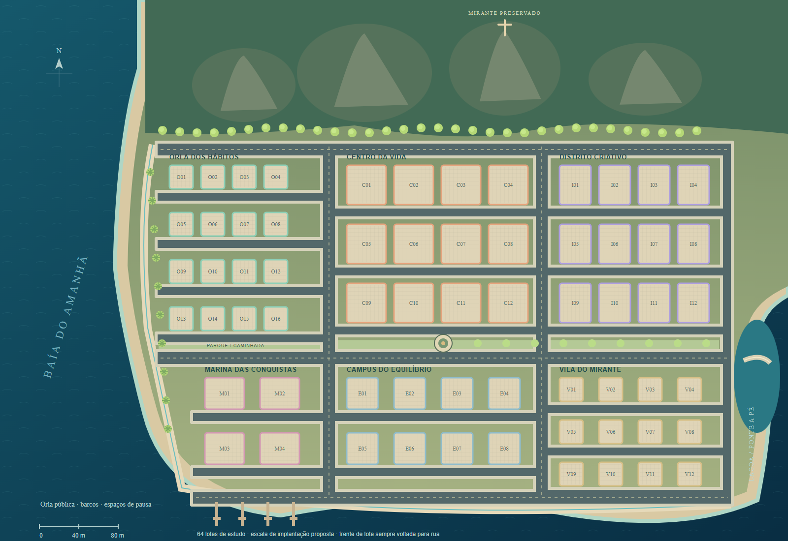

# Cityou

Organize sua vida e transforme progresso real em uma cidade sua, inspirada no Rio de Janeiro.

**Protótipo local em desenvolvimento.** O painel pessoal e a cidade jogável estão implementados. O mapa Baía do Amanhã é uma proposta interativa separada; ainda não substitui o terreno da cidade 3D.



## O que existe hoje

- Painel pessoal com tarefas, agenda, hábitos, metas, Fitness, alimentação, autoconhecimento, estudos, finanças, projetos, biblioteca e memórias.
- Cidade 3D com catálogo, prévia de construção, mover, girar, melhorar, remover e salvamento em SQLite.
- Moedas por tarefas, hábitos e metas concluídos (no app publicado, guardados no próprio Cityou; no servidor local, as tarefas ainda vêm da fonte Fifones opcional); nenhuma renda automática por tempo aberto.
- Prédios GLB ambientados no terreno do Rio. A cidade não lê mais sinais de atividade do Fifones.
- Planta interativa com 64 lotes em seis bairros: seleção, dimensões, rotação, teste de encaixe, rascunho local e exportação.
- Mapa-mundo BuildU: globo low poly com 8 espaços desbloqueados em sequência (ilha inicial + sete maravilhas), progresso em localStorage e modo debug. Veja [docs/WORLD-MAP.md](docs/WORLD-MAP.md).

## Executar no computador

Requisitos: Node.js 20.19+ ou 22+, Python 3.13 e Git. Os comandos abaixo são para PowerShell, a partir da pasta clonada.

```powershell
git clone https://github.com/luizfelipeulhoa-afk/Cityou.git
cd Cityou
npm ci
npm run build
python -m venv .venv
.\.venv\Scripts\python.exe -m pip install -r backend/requirements.txt
.\.venv\Scripts\python.exe -m backend
```

Abra:

- Painel pessoal: http://127.0.0.1:8766/
- Cidade jogável: http://127.0.0.1:8766/city.html
- Proposta do mapa: http://127.0.0.1:8766/mapa-cityou/
- Mapa-mundo BuildU: http://127.0.0.1:8766/world.html (debug: `?debug=1` ou tecla D)

No Linux/macOS, use `.venv/bin/python` no lugar do caminho Windows.

Para desenvolver o frontend, mantenha o backend aberto e execute `npm run dev` em outro terminal. O Vite abre em http://127.0.0.1:5177/ e encaminha `/api` ao backend local.

## Fonte Fifones opcional

A fonte original é consultada em http://127.0.0.1:8765. Sem ela, a cidade e os registros pessoais locais continuam salvos, mas tarefas, projetos, documentos, agenda, voz Gemini e recursos avançados dependentes da fonte ficam indisponíveis. A instalação original, as credenciais e seus dados não fazem parte deste repositório. `tools/source_bridge.py` é um adaptador opcional para uma instalação existente em `~/Desktop/Fifones`.

No app publicado (Worker do Cloudflare), as tarefas já são do próprio Cityou e a cidade não abre mais o Fifones; o resto sai etapa por etapa, conforme [docs/PLANO-PROXIMOS-PASSOS.md](docs/PLANO-PROXIMOS-PASSOS.md).

O ledger da cidade está em `data/city.sqlite3`; os registros pessoais, em `data/personal.sqlite3`. Esses arquivos são criados localmente e ignorados pelo Git. `CITY_DATA_DIR` permite escolher outra pasta e `FIFONES_UPSTREAM` permite outra origem HTTP de loopback.

## Testes

```powershell
.\.venv\Scripts\python.exe -m pip install -r backend/requirements-dev.txt
.\.venv\Scripts\python.exe -m pytest tests -q
npm test
npm run test:map
npx playwright install chromium
npm run test:ui
```

Os testes de interface usam fontes e bancos temporários, separados dos dados reais. `CITYOU_PYTHON`, `CITYOU_CHROME` e `CITYOU_PLAYWRIGHT_MODULE` permitem selecionar runtimes locais opcionais. O teste de interface da planta (`node tools/map-plan-playtest.mjs`) requer o servidor local ativo em 8766.

## Estado e limites

Este repositório publica o **código**, não um serviço hospedado. O backend escuta apenas em 127.0.0.1 e foi desenhado para uso pessoal local, sem autenticação multiusuário. Publicar o backend na internet exige uma etapa própria de arquitetura e segurança.

Os recursos avançados do Fifones original não foram reimplementados aqui. O diário alimentar não calcula nutrientes por imagem. A planta de 64 lotes ainda não é o mapa da cidade jogável. Veja [funcionalidades e limites](README-FIFONES.md) e [estudo do mapa](docs/CITYOU-MAP-STUDY.md).

## Créditos e licenças

Cityou reutiliza partes do CubeCity (MIT), revisão `0191f5170872382954c15b7316f2e34d020d6d49`. O aviso original está preservado em [LICENSE](LICENSE). A cópia de publicação inclui os módulos usados pelo Cityou; os pacotes de modelos e áudio não usados do upstream não foram incluídos.

Fontes Figtree e Newsreader: SIL Open Font License, avisos em `public-fifones/fonts/licenses/`. Modelos 3D e imagens fornecidos/criados para este projeto são distribuídos como assets do projeto; a licença MIT do código não concede direitos sobre marcas ou material de terceiros. As marcas pertencem aos respectivos titulares. Veja [proveniência](docs/PROVENANCE.md) e [licenças dos assets](ASSETS.md).
